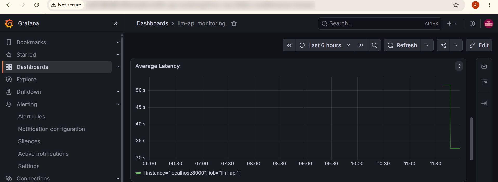
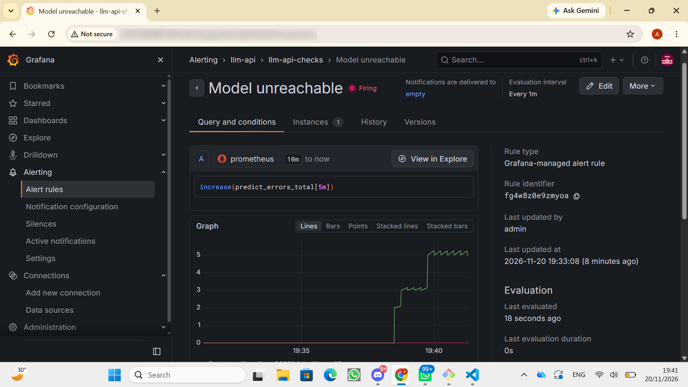

# llm-api

A FastAPI service that serves an open-source LLM (`llama3.2:1b` via Ollama) and measures its performance on every request: latency, tokens generated, and tokens/sec. Containerized with Docker, built and pushed by GitHub Actions, deployed on an Azure VM (CPU only), and monitored with Prometheus + Grafana, including an alert when the model is unreachable.



## Architecture

**Request flow**
```
Browser
 → NSG (Azure firewall: allows only my IP on port 8000)
 → VM:8000
 → Container (--network host, so the VM's 8000 = uvicorn's 8000)
 → Uvicorn (server, runs the app)
 → FastAPI (finds /predict; Pydantic checks the request body)
 → predict() → requests.post()
 → Ollama (localhost:11434, llama3.2:1b)
 → answer + metrics back to the browser
```

**Monitoring flow**
```
llm-api /metrics  →  Prometheus (scrapes every 15 s, keeps history)  →  Grafana (dashboard + alert)
```

## Tech stack

- **Model:** llama3.2:1b, served by Ollama
- **API:** Python, FastAPI, Uvicorn, Pydantic
- **Container:** Docker, Docker Hub (`kesoiso/llm-api`)
- **CI/CD:** GitHub Actions
- **Cloud:** Azure VM (Ubuntu 24.04, 2 vCPU, 4 GB RAM, CPU only)
- **Monitoring:** prometheus_client (Python), Prometheus, Grafana

## Endpoints

| Endpoint | Method | What it does |
|---|---|---|
| `/` | GET | Health message |
| `/predict` | POST | Sends a prompt to the model, returns the answer + latency, tokens, tokens/sec |
| `/metrics` | GET | Metrics in Prometheus text format |
| `/docs` | GET | Swagger UI to test the API in the browser |

## How to run it

You need [Ollama](https://ollama.com) running with the model: `ollama pull llama3.2:1b`

**1. Laptop (Python)**
```bash
python -m venv venv
source venv/Scripts/activate    # Windows Git Bash
pip install -r requirements.txt
uvicorn main:app --reload
```
Open http://127.0.0.1:8000/docs

**2. Laptop (Docker Compose)**
```bash
docker compose up --build
```
Open http://127.0.0.1:5000/docs

**3. Linux server / cloud VM (image from Docker Hub)**
```bash
docker run -d --name llm-api --network host --restart unless-stopped \
  -e OLLAMA_URL=http://localhost:11434/api/generate \
  kesoiso/llm-api
```
Open http://<SERVER_IP>:8000/docs

### Example request
```bash
curl -X POST http://127.0.0.1:8000/predict \
  -H "Content-Type: application/json" \
  -d '{"prompt": "What is Docker?"}'
```

### Example response
```json
{
  "ai_response": "...",
  "latency_seconds": 20.66,
  "tokens_generated": 67,
  "tokens_per_second": 8.93
}
```

## Monitoring

### Metrics exposed at `/metrics`

| Metric | Type | Meaning |
|---|---|---|
| `predict_requests_total` | Counter | All requests to /predict (success + failed) |
| `predict_errors_total` | Counter | Failed requests (503: model unreachable) |
| `predict_latency_seconds` | Histogram | Latency of successful requests, buckets: 5, 10, 20, 30, 60, 120 s |

### Run Prometheus and Grafana (on the same VM)

Prometheus config: [`monitoring/prometheus.yml`](monitoring/prometheus.yml) (scrapes `localhost:8000/metrics` every 15 s).

```bash
docker run -d --name prometheus --network host --restart unless-stopped \
  -v ~/monitoring/prometheus.yml:/etc/prometheus/prometheus.yml \
  prom/prometheus

docker run -d --name grafana --network host --restart unless-stopped \
  grafana/grafana
```
- Prometheus: http://<SERVER_IP>:9090
- Grafana: http://<SERVER_IP>:3000 (add Prometheus as a data source: `http://localhost:9090`)

### Grafana dashboard: `llm-api monitoring`

| Panel | PromQL |
|---|---|
| Total requests | `predict_requests_total` |
| Errors | `predict_errors_total` |
| Average latency | `predict_latency_seconds_sum / predict_latency_seconds_count` |
| Latency buckets | `predict_latency_seconds_bucket` |
| Requests per second | `rate(predict_requests_total[5m])` |
| Total requests (stat) | `predict_requests_total` |

### Alert: "Model unreachable"

- Rule: `increase(predict_errors_total[5m]) > 0`, checked every 1 minute, pending period 1 minute
- Tested by stopping Ollama on purpose: 503s → Pending → **Firing** → restarted Ollama → back to **Normal** after ~5 minutes



## Results (CPU only, no GPU)

| Where | Latency | Tokens | Tokens/sec | Note |
|---|---|---|---|---|
| Laptop (cold start) | 51 s | — | — | model loading |
| Laptop (warm start) | 7 s | — | ~8–10 | model already loaded |
| Laptop (Docker Hub image) | 13.17 s | 31 | 8.38 | |
| Azure VM (cold) | 110.37 s | 731 | 8.16 | ~17.5 s model load |
| Azure VM (after reboot) | 20.66 s | 67 | 8.93 | 13.16 s overhead |
| Azure VM (long answer) | 51.67 s | 322 | 8.10 | |
| Azure VM (short answer) | 14.04 s | 18 | 9.03 | |
| Azure VM (Prometheus average, 4 requests) | 48.29 s | — | — | all between 30 and 60 s |

**Key findings**
- Cold start is the biggest delay (up to 51 s on the laptop).
- A 2 vCPU cloud VM is about as fast as my laptop: ~8–9 tokens/sec on CPU.
- Speed stays the same, so longer answers take longer: 18 tokens = 14 s, 322 tokens = 52 s.
- The average latency went **up** when I expected it to go down (cold start after idle + long answers). Measure, don't assume.

## What I learned

- Debugging a 503: the VM got traffic, but the container couldn't reach Ollama because of a typo in an env variable. Lesson: check, don't assume.
- Docker: build once, run anywhere (laptop, CI runner, cloud VM).
- Environment variables: the same image works in different environments.
- CI/CD with GitHub Actions: every push is tested, built and pushed to Docker Hub automatically.
- Cloud VMs in practice: SSH, firewalls (NSG), ports, auto-restart, cost control.
- Monitoring: Counter vs Histogram, scraping, PromQL (`rate()`, `increase()`), dashboards and alerts.
- HTTP: GET vs POST, status codes (200, 422, 503), JSON and YAML.
- Small models (1B) hallucinate facts, so measure and verify.

## Next steps

- Kubernetes: run llm-api + Prometheus + Grafana on a cluster
- Nginx + HTTPS, and an API key
- Grafana alert notifications (email/Slack)
- vLLM on a GPU (Colab/Kaggle) and compare tokens/sec
